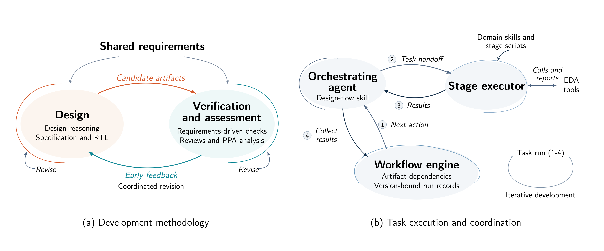
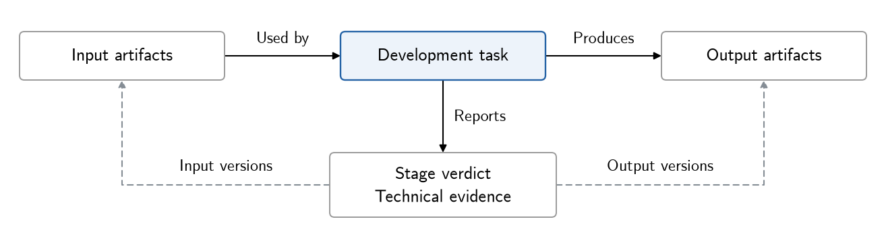

# VeriPower 架构

[English](ARCHITECTURE.md)

## 总体设计

VeriPower 是一套面向 coding agent 的芯片前端开发方法，以插件形式接入通用 agent harness，例如 Claude Code、OpenCode、DeepSeek Harness 和 Codex。它以螺旋式工程思想组织多轮开发，使设计与检验在持续反馈和关联修订中，围绕共同的功能要求和功耗、性能、面积（PPA）目标协同演进。开发任务的完成既要求所需成果齐备、满足需求且相互配套，也要求规定的开发活动实际完成。

**领域 skills** 为设计论证、需求驱动验证和修订分析提供专业指导，阶段脚本支持工具执行与检查。**流程引擎**依据成果依赖和运行记录协调执行。编排 agent 通过 agent harness 组织任务执行与结果收取。

<!-- Reused unchanged from the VeriPower paper. -->

  
   
  开发方法与执行机制 · <a href="../assets/veripower-methodology-and-mechanisms.png">查看原图</a>

## 开发任务与领域指导

每项开发任务明确输入、工作目标、领域指导和交付内容。具有独立交付与判定责任的技术任务称为**阶段**。阶段执行者在本任务范围内形成和检查成果，提交阶段判定及其技术证据。

领域指导涵盖三个相互关联的方面：

- **设计论证。** 规格与 RTL 实现任务结合自顶向下的需求细化与自底向上的可行性分析。规格明确共同边界和约束，RTL 执行者依据设计论证确定内部划分。
- **需求驱动验证。** 规格通过自身检查后，验证规划据此开展。预期行为依据需求和独立参考材料建立。独立评审核查激励、观测和检查逻辑能否检出不符合要求的行为，并触发失败判定；仿真、静态检查和 PPA 分析提供进一步反馈。
- **修订分析。** 执行者结合成因诊断与修改影响评估，确定负责修改的任务，并分析修订对其他要求及成果配套关系的影响。

共同需求贯穿这些任务。规格将原始要求整理为需求台账，赋予稳定标识。设计决定、测试点、测量和判定通过这些标识关联到相应要求。台账和规格在形成与修订时均对照原始材料核查，使设计与检查始终以任务要求为依据。

阶段脚本检查成果结构、执行结果和所支持的数值目标。执行者对照需求核查分析范围与测量含义，报告技术判断。阶段 CLI 以统一结果格式记录这些结果。阶段的通过判定针对本任务的交付与检查范围，后续反馈可进一步确认或修订相关设计选择。

## 跨轮次的开发协调

### 任务、成果与阶段结论

阶段声明明确任务输入和成果归属。成果的提供与使用关系构成依赖图，用于调度和确定修复范围。执行者修订本任务负责的成果；反馈要求修改共同设计决定或其他任务成果时，由负责相应成果的任务实施修订，并协调受影响的工作。

任务交接和结果提交连接技术工作与流程协调。编排 agent 请求引擎依据当前成果和运行记录选择工作，交接材料提供本轮输入、已有成果和返工依据。编排者按阶段声明，在主对话或后台子 agent 中组织执行。通过 agent harness 确认执行者结束后，再调用引擎收取结果、发布成果并更新运行记录，据此决定后续工作。

每次运行记录声明输入和交付输出的版本，将阶段结论与这些成果关联起来：

<!-- Reused unchanged from the VeriPower paper. -->

  
   
  任务、成果与结论 · <a href="../assets/veripower-task-artifact-relations.png">查看原图</a>

阶段当前结论取自最新收取的结果。该结果通过，且本次记录的输入和输出仍可读、内容指纹匹配时，已有结论仍适用于当前成果。后续收取的失败或受阻结果取代此前通过结果。版本核对维护结论与当前成果的对应关系，结论的技术含义由检验方法及其分析范围确定。

### 诊断与关联修订

以仿真在合法输入上发现输出误差为例。执行者结合实现、预期值和测试设置分析成因。如果缺陷位于 RTL，RTL 任务根据诊断结果修订实现。修复精度问题可能增加周期或控制状态，因此还需评价延迟预算、复位行为及相关测试。

可承担修订的任务包括失败阶段自身，以及直接或间接为其提供输入的上游任务。引擎将同一任务负责的问题合并到一次返工。仿真失败且修改归属尚不明确时，由专门的诊断任务调查该次失败运行。未解决的归因交回编排者，进一步调查或按任务授权作出决定。

引擎依据成果依赖识别可能受影响的任务，执行者分析修改的实际影响，确定可复用的证据和需要重新开展的检验。独立任务可以并行；依赖修订成果的检查须等待上游返工完成、输入可用，且上游任务具有当前有效的通过结果。后续迭代由此承接已有成果和适用结论。

### 多轮衔接与完成判断

成果和运行记录保存在模块工作目录中，支撑跨轮次和跨会话的工作衔接。中断后，编排者识别尚未收取的运行，核实相关执行者是否仍在运行，再接续安排待办工作。引擎记录结果收取情况，agent harness 提供执行者是否结束的信息。

所有必需阶段的通过结果均适用于当前成果，且全部已派发运行均已收取时，流程完成。编排者对照原始需求汇总判定和技术证据，并说明仍然存在的限制。

任务要求形成接受记录时，编排者通过 `decide --closing` 核查必需阶段的发布文件是否被最新输出记录覆盖，运行历史除外；随后按授权通过 `signoff` 记录接受决定，将其绑定到当时的证据。

## 集成与实现

Agent harness 提供模型交互、上下文、文件和 shell 工具、子 agent 及执行权限。适配器将共享 skills 和编排映射到 agent harness 的原生能力。EDA 工具作为外部程序运行，产生阶段使用的报告和成果。工程师提供需求并明确授权范围；任务授权与 agent harness 的执行权限分别生效。

实现沿这些边界组织：

| 职责 | 入口 |
|---|---|
| 工程方法、评审与工具工作 | [阶段 skills](../skills/) 及其参考材料和脚本 |
| 阶段结果接口 | [公共结果 schema](../framework/references/schemas/envelope.schema.json) |
| Agent 编排 | [design-flow](../skills/design-flow/SKILL.md) |
| 任务声明与成果依赖 | [rules.py](../framework/scripts/rules.py) |
| 结果有效性、调度与发布 | [kernel.py](../framework/scripts/kernel.py) 和 [framework 组件](../framework/README.md) |
| Agent harness 适配 | [Claude Code](../.claude/README.md)、[OpenCode](../.opencode/README.md)、[DeepSeek Harness](../.dsh/README.md)、[Codex](../.codex-plugin/README.md) |

准备、运行和交付复核见[用户指南](USER-MANUAL.zh.md)，开发与验证约定见 [Contributing](../CONTRIBUTING.md)。
